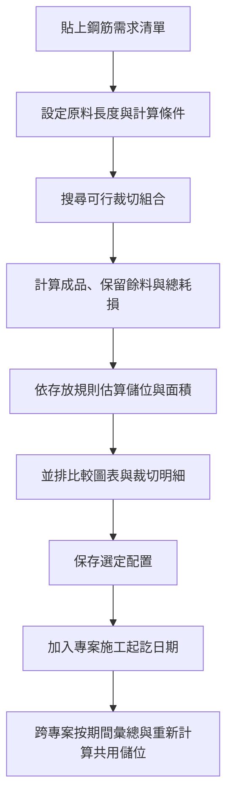

# 鋼筋裁切與儲位規劃分析工具

### 從需求清單，到裁切方案，再到跨專案空間分析

Windows 桌面應用程式作品集｜Python · OR-Tools · Tkinter

將鋼筋需求整理、原料長度選擇、裁切耗損與儲位估算整合在同一個分析流程，協助使用者比較不同配置的取捨。

> 本頁僅展示作品功能與模擬案例。原始碼保留於私人儲存庫；此公開儲存庫不提供原始碼、執行檔、公司圖面或實際專案資料。

## 解決的問題

面對不同號數、長度與數量的鋼筋需求，單看裁切耗損不足以評估整體配置。採購長度、保留餘料及材料分格方式，也會影響所需的儲存空間。多個專案同時進行時，還需要比較不同月份與時段的需求量及估算格數。

這個工具讓使用者輸入需求與可調參數，取得可行裁切方案，再用相同指標比較材料利用情況與儲存空間。

## 功能展示

| 功能 | 使用者可以做什麼 |
| --- | --- |
| 需求輸入 | 從 Excel 貼上「號數、長度 mm、數量、型式」，查看已匯入列數 |
| 原料選擇 | 指定可採購長度清單，或以長度範圍與級距產生候選長度 |
| 裁切分析 | 比較單一原料長度與混合長度的裁切方案 |
| 耗損分類 | 分別查看每刀耗損、低於門檻的短餘料廢料及保留餘料 |
| 儲位估算 | 設定架寬、高、長與容積使用率，計算整數格數及占地面積 |
| 圖表比較 | 用環形圖、直條圖及 XY 圖比較材料使用與儲位需求 |
| 配置保存 | 保存需求、參數與選定方案，方便日後載入與比較 |
| 跨專案彙總 | 按施工期間分攤材料量，查看每月、每季或指定時段的估算結果 |

## 操作流程

## 材料如何計算與存放

| 材料階段 | 分析規則 |
| --- | --- |
| 未切原料 | 按原料長度分組；相同長度的不同號數可共用儲位，不同長度分格 |
| 裁切需求 | 仍按號數滿足各自需求，不以其他號數替代材料 |
| 廠內成品 | 保留型式與需求明細，成品暫存預留格數及暫存天數可設定 |
| 可利用餘料 | 達到最短保留門檻才保留，按號數與長度級距分類；小量餘料依合併規則估算空間 |
| 廢料 | 計入耗損，不占用材料儲位 |

**容積使用率**是使用者設定的容量折減係數；**實際格位填充率**是該組材料重量除以已配置格位的可用容量。各分組向上取整，以呈現放不滿一格仍需占用空間的情況。

## 模擬案例：看懂一組裁切結果

以下數字為自行建立的示意資料，僅展示材料長度平衡，並非實際專案或最佳化績效宣稱。

| 項目 | 示意設定／結果 |
| --- | --- |
| 成品需求 | 同號數鋼筋 5.9 m × 20 支 |
| 可用原料 | 12 m |
| 每刀耗損 | 0 cm |
| 可利用餘料最短長度 | 50 cm |
| 一組可行切法 | 每支原料切出 5.9 m × 2 支，剩下 0.2 m |
| 原料需求 | 12 m × 10 支，共 120 m |
| 成品總長 | 118 m |
| 短餘料廢料 | 0.2 m × 10，共 2 m |
| 長度利用率 | 118 ÷ 120 ≈ 98.33% |

因為每支剩下的 20 cm 低於 50 cm 保留門檻，此案例將其列為廢料。實際重量與儲位仍需依鋼筋直徑、密度、架體尺寸及容積使用率計算。

## 跨專案分析的設計

1. 保存各專案的需求、參數與選定切法。
2. 依各自施工起訖日期，按日數比例分攤材料量。
3. 在選定時段合併相同原料長度的材料，再重新計算共用儲位。
4. 依成品暫存天數估算暫存需求，保留全場共用預留區並列出超量需求。
5. 每月顯示整數格數；季度與指定期間採月段高峰，避免把各月儲位直接相加。

這是依均勻施工進度推估的分析模型；尚未接入實際進出庫紀錄，也未執行跨專案餘料重新配切。

## 開發重點

- 將現場討論轉換為可調參數、材料分類與可追溯的計算明細。
- 使用 Python、OR-Tools 與 Tkinter 建置桌面分析流程，並打包為 Windows 單一執行檔。
- 透過背景計算、進度顯示及使用者可設定的求解上限處理較大需求清單。
- 區分可行方案與已證明最佳結果；限時搜尋可能取得可行解，但不保證全域最佳。
- 使用自動測試檢查材料平衡、分組規則、跨專案彙總及大量資料貼上；本次版本共 74 項測試通過。

---

本儲存庫為公開展示用途。所有案例均為模擬資料，不包含公司名稱、專案代號、圖面、內部路徑、供應商資訊或真實需求清單。
